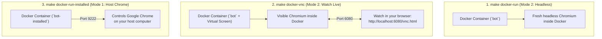

# AI Browser Automation Boilerplate (`browser-use`)

Welcome! This repository is a ready-to-use starter kit for **AI browser automation** across **macOS, Linux, and Windows**. It uses **[browser-use](https://github.com/browser-use/browser-use)** and an **AI API key** (we recommend **Google Gemini** because it is fast, supports screenshots, and costs the least).

Everything you need to know — what makes automation reliable in production, choosing a browser mode, running with or without Docker, and adding your own custom automation processes — is in this single document.

---

## Table of Contents

1. [What Makes Browser Automation Robust (Production Guide)](#1-what-makes-browser-automation-robust-production-guide)
2. [The Big Picture: 2 Browser Modes & 2 Ways to Run](#2-the-big-picture-2-browser-modes--2-ways-to-run)
3. [First-Time Setup (`.env`)](#3-first-time-setup-env)
4. [How to Run Tasks (Native vs. Docker Side-by-Side)](#4-how-to-run-tasks-native-vs-docker-side-by-side)
5. [Understanding the 2 Browser Modes in Detail](#5-understanding-the-2-browser-modes-in-detail)
6. [Understanding the Docker Setup in Detail](#6-understanding-the-docker-setup-in-detail)
7. [How to Modify the Project for Your Own Process](#7-how-to-modify-the-project-for-your-own-process)
8. [Prompting Best Practices (Production Lessons)](#8-prompting-best-practices-production-lessons)
9. [Project Structure & Architecture](#9-project-structure--architecture)
10. [Troubleshooting Common Issues](#10-troubleshooting-common-issues)

---

## 1. What Makes Browser Automation Robust (Production Guide)

Building a demo that works once is easy; building an automation that runs reliably day after day without getting blocked or breaking on UI changes requires a few key principles.

### 1. Why `browser-use` + Gemini Is Superior to Traditional Automation

Traditional tools (**Selenium, Playwright scripts, Puppeteer**) rely on **hardcoded XPaths and CSS selectors** (`//div[@class='xyz']/button[2]`). They break the moment a website changes a class name, adds a popup banner, A/B tests a button layout, or displays the page in another language.

**Why `browser-use` + Google Gemini wins in production:**
- **Understands meaning, not fragile selectors:** The AI reads both the **live DOM elements** and a **visual screenshot (`USE_VISION=true`)** on every step. If a button moves, changes its HTML tag, or appears in Japanese instead of English, the agent still finds and clicks the right button.
- **Handles unexpected popups and slow loading states:** Instead of crashing with `ElementClickInterceptedException` when a cookie banner or "Got it" dialog appears, the agent sees the dialog, closes it, and continues.
- **Vision at a fraction of the cost:** Sending screenshots on every step with other frontier models becomes expensive fast. **Google Gemini Flash (`gemini-3.6-flash` / `gemini-2.5-flash`)** has strong visual UI understanding while costing a fraction of a cent per task — making vision-enabled automation practical at scale.
- **Structured outcomes instead of blind clicks:** Instead of hoping a click worked, the agent visually verifies the confirmation message on screen and returns a strict Pydantic `Output` (`SUCCESS`, `QUOTA_EXCEEDED`, `NEEDS_LOGIN`) with the exact `evidence` text.

---

### 2. Why Installed Chrome (Mode 1) vs. New Browser Instance (Mode 2) Matters So Much

Choosing between **Mode 1 (`installed`)** and **Mode 2 (`fresh`)** is not just convenience — it directly affects **trust, login survival, and bot detection**:

| Factor | Mode 1: Installed Chrome (`installed` — Recommended) | Mode 2: New Instance (`fresh`) |
|---|---|---|
| **Browser Fingerprint & Trust** | Runs the **real, official Google Chrome binary** on your OS with normal codecs, GPU rendering, and TLS/HTTP2 signatures. | Uses a fresh/Playwright Chromium instance that starts with an empty history and a "new browser" profile. |
| **Cookies & Account Trust Score** | Reuses an **aged profile** (`./profiles/installed`) with existing cookies, browsing history, and active sessions. Websites treat it like a returning human user. | Starts completely cold (`ephemeral`) or in a fresh isolated folder (`persistent`) with no prior history. |
| **Login & 2FA Friction** | **Log in once by hand** (`make chrome`), and the browser stays open all day (`keep_alive=True`). No repeated logins that trigger security alerts. | Logging in from scratch on every run quickly triggers "suspicious login" emails, 2FA prompts, and CAPTCHAs. |
| **When to Choose** | **Always use Mode 1** for logged-in accounts (Google, admin portals, social/SaaS dashboards) and anti-bot-sensitive websites. | Use Mode 2 for public pages, stateless scraping, or isolated tests where no login is needed. |

---

### 3. CAPTCHAs: Automation Does Not Solve CAPTCHAs by Itself

A critical rule for reliable automation:
> **Do not ask the LLM browser agent to click through reCAPTCHA, hCaptcha, or Cloudflare Turnstile puzzles.**

- AI vision models are **not** designed to solve interactive image-grid CAPTCHAs or bypass behavioral challenge tokens — trying to brute-force them with LLM steps wastes tokens and lowers your IP/account trust score even further.
- **What to do instead:**
  1. **Prevent CAPTCHAs first** by using **Mode 1 (`installed`)** with a warm, already-logged-in Chrome profile and human-like pacing (this avoids 90%+ of CAPTCHAs in the first place).
  2. **Stop cleanly when a CAPTCHA appears:** In your task prompt, always include an early-exit rule:
     ```text
     If you see a CAPTCHA, "unusual traffic", or "verify you are human" screen, stop immediately and finish with BLOCKED_OR_CAPTCHA.
     ```
  3. **Use a dedicated CAPTCHA-solving service when solving is required:** If your workflow must pass CAPTCHAs automatically, integrate a specialized solver API or browser extension such as **[CapSolver](https://www.capsolver.com/)** or **[2Captcha](https://2captcha.com/)**:
     - **Extension approach (easiest with Mode 1):** Install the CapSolver or 2Captcha Chrome extension inside your Mode 1 profile (`make chrome`), enter your solver API key in the extension settings once, and let the extension solve challenges automatically in the background.
     - **API / Custom Tool approach:** Register a custom `@tools.action` function on your task (see [Step 4 in Section 7](#step-4-optional-adding-custom-python-tools-toolsaction)) that sends the sitekey/page URL to the CapSolver or 2Captcha API and injects the returned token into the page.

---

### 4. The Importance of Human Behavior & How to Adapt It

Websites detect bots not only by browser headers, but by **how fast and how mechanically** actions happen (instant 0ms clicks, opening 20 tabs per minute, clicking a submit button 5 times while a spinner is still loading, or running 24/7 without breaks).

**How this boilerplate adapts human behavior (and how you can tune it):**

1. **Natural pauses between actions (`WAIT_BETWEEN_ACTIONS`):**
   - Set `WAIT_BETWEEN_ACTIONS=0.5` (or `1.0`–`2.0` on stricter sites) in `.env` so the browser waits between every click, scroll, and keystroke instead of acting at machine speed.
2. **One action at a time (`max_actions_per_step=1`):**
   - Configured by default in [`app/agent_factory.py`](app/agent_factory.py). Instead of firing a blind batch of 5 clicks at once, the agent performs **one** action, looks at the updated page like a human would, and then decides the next step.
3. **Waiting for spinners & never double-clicking (`system_rules`):**
   - Always instruct the agent in `system_rules`:
     ```python
     system_rules = (
         "Act carefully like a real person: wait for loading spinners and dialogs to finish before acting. "
         "Click submit buttons at most ONCE and wait patiently for the result."
     )
     ```
4. **Keep a single warm tab open (Mode 1):**
   - Real users don't launch and kill their entire browser 100 times a day. In Mode 1, Chrome opens once at the start of your work session and reuses the same tab across tasks.
5. **Add random jitter between tasks when running batches:**
   - When calling `run_task()` in a loop over many items, add a randomized human pause (`await asyncio.sleep(random.uniform(5, 20))`) between tasks and run within normal working hours rather than hammering a target site non-stop.

---

## 2. The Big Picture: 2 Browser Modes & 2 Ways to Run

Before running anything, there are only two choices you ever make:

### Choice A: Which Browser Should the AI Control?

| Mode | Name in `.env` / CLI | How It Works | Best For |
|---|---|---|---|
| **Mode 1: Installed Browser (Recommended)** | `installed` | Controls the **real Google Chrome installed on your computer**. Chrome stays open after the task finishes, so your logins, cookies, and open tabs stay alive all day. | Sites where you are already logged in (Google, dashboards, 2FA accounts). |
| **Mode 2: Fresh Instance** | `fresh` | Starts a **brand-new, separate browser** just for this run and closes it when done. It never touches your personal Chrome. | Clean scraping, testing, public forms, or running invisibly on a server. |

### Choice B: How Do You Want to Run the Code?

| Approach | How It Works | Best For |
|---|---|---|
| **Without Docker (Native via `uv`)** | Runs Python directly on your Mac, Linux, or Windows machine. | Everyday local work and controlling your desktop Chrome. |
| **With Docker (`docker compose`)** | Runs Python (and optionally the browser) inside a container so you only need Docker installed. | Servers, team sharing, or isolated environments. |

---

## 3. First-Time Setup (`.env`)

1. Copy the example environment file:
   ```bash
   cp -n .env.example .env
   ```
2. Open `.env` and paste your Gemini API key:
   ```ini
   LLM_PROVIDER=google
   GEMINI_API_KEY=your_gemini_api_key_here
   ```
3. Perform the one-time install for whichever way you want to run:
   - **Without Docker (Native):**
     ```bash
     make setup            # Installs Python packages with uv
     make doctor           # Verifies API key, installed Chrome, and Mode 2 browser
     ```
   - **With Docker:**
     ```bash
     make docker-build     # Builds the container image (Python + Chromium + virtual screen)
     ```

---

## 4. How to Run Tasks (Native vs. Docker Side-by-Side)

Every action has a matching `make` command whether you run **without Docker** or **with Docker**:

| What You Want to Do | Without Docker (Native `uv`) | With Docker (`docker compose`) |
|---|---|---|
| **List all available tasks** | `make tasks` | `docker compose run --rm bot bub tasks` |
| **Run in Mode 1 (Installed Chrome on your computer)** *(Recommended)* | `make run-installed TASK=hn_top_stories INPUT="count=5"` | `make chrome` *(once on host)*, then:<br>`make docker-run-installed TASK=hn_top_stories INPUT="count=5"` |
| **Run in Mode 2 (Fresh browser instance)** | `make run-fresh TASK=hn_top_stories INPUT="count=5"` | `make docker-run TASK=hn_top_stories INPUT="count=5"` |
| **Watch Mode 2 live in a visible window** | `make run-fresh TASK=httpbin_form INPUT="customer=Salman"` *(visible by default)* | `make docker-vnc TASK=httpbin_form INPUT="customer=Salman"`<br>*(watch at `http://localhost:6080/vnc.html`)* |
| **Run Mode 2 invisibly (headless)** | `make run-fresh HEADLESS=1 TASK=hn_top_stories INPUT="count=5"` | `make docker-run TASK=hn_top_stories INPUT="count=5"` *(headless by default)* |
| **Run a one-line free-text instruction (no code needed)** | `make prompt P="Open https://example.com and read the heading"` | `make docker-run TASK=prompt INPUT='text=Open https://example.com and read the heading'` |
| **Check today's AI token cost** | `make cost` | `docker compose run --rm bot bub cost` |

---

## 5. Understanding the 2 Browser Modes in Detail

### Mode 1: Installed Browser (`BROWSER_MODE=installed` — Recommended)

In Mode 1 (`app/browser/installed.py`), the AI connects to the real Google Chrome installed on your Mac, Linux, or Windows computer over Chrome's DevTools port (`CDP_PORT`, default `9222`).

- **Stays open between runs:** When a task finishes, Chrome is **not** closed (`keep_alive=True`). Your tabs, cookies, and logins remain ready for the next task.
- **Two connection options (`INSTALLED_ACTION` in `.env`):**
  - `launch` *(default)*: If Chrome isn't open on port `9222` yet, the tool automatically launches it for you using `./profiles/installed`. If it's already open, it reuses it.
  - `attach`: Connects only to a Chrome you already started with `make chrome` (or `./scripts/launch_chrome.sh` on macOS/Linux, `.\scripts\launch_chrome.ps1` on Windows).

#### ⚠️ Important Note on Chrome 136+ and Profiles
Starting in Chrome 136, Google Chrome ignores `--remote-debugging-port` if you point it directly at your operating system's default Chrome folder. That is why this project uses a dedicated profile folder (`./profiles/installed`). You have two easy ways to use your accounts in Mode 1:

1. **Log in once inside the automation Chrome (Easiest):**
   ```bash
   make chrome
   ```
   A Chrome window opens using `./profiles/installed`. Sign in to Google or your target sites once. Those logins are saved on disk for all future runs.
2. **Or copy an existing Chrome profile into `./profiles/installed`:**
   Quit your regular Chrome completely, then run:
   ```bash
   make copy-profile PROFILE="Default"
   # Or for another profile folder:
   make copy-profile PROFILE="Profile 1"
   ```

#### Useful Mode 1 Helper Commands
```bash
make chrome          # Start installed Chrome with debug port 9222
make chrome-status   # Check if Chrome is listening on port 9222
make chrome-stop     # Close the Chrome started by `make chrome`
```

---

### Mode 2: Fresh Instance (`BROWSER_MODE=fresh`)

In Mode 2 (`app/browser/fresh.py`), `browser-use` starts a brand-new browser just for the task and closes it as soon as the task ends.

- **Two profile options (`FRESH_PROFILE` in `.env`):**
  - `ephemeral` *(default)*: Creates a temporary folder before the run and deletes it afterward. Every run starts 100% clean with zero cookies.
  - `persistent`: Saves the profile in `./profiles/fresh/<FRESH_PROFILE_NAME>` so cookies are remembered across runs while still keeping the browser separate from your personal Chrome.
- **Installing a standalone Chromium binary (optional):** If a machine doesn't have Chrome installed, run `make install-browser` (`uvx playwright install chromium`).

---

## 6. Understanding the Docker Setup in Detail

Even if you run inside Docker, you don't lose flexibility. Here is what the three Docker files in the root folder do and how the three `make docker-*` commands work:



### What the 3 Docker Files Do
1. **[Dockerfile](Dockerfile):** Builds one image with Python 3.12, `uv`, all dependencies, Playwright **Chromium**, international fonts, and a virtual desktop (**Xvfb + x11vnc + noVNC**).
2. **[docker-compose.yml](docker-compose.yml):** Defines two services (`bot` for Mode 2 inside Docker, `bot-installed` for Mode 1 attached to your computer's Chrome). It mounts `./app/tasks`, `./logs`, and `./profiles` from your computer into the container — **so when you add or edit a task in `app/tasks/`, you DO NOT need to rebuild the Docker image**.
3. **[docker-compose.linux.yml](docker-compose.linux.yml):** Automatically included by the `Makefile` on Linux so `make docker-run-installed` can reach your host Linux Chrome on `127.0.0.1:9222`.

### How the 3 Docker Commands Work
1. **`make docker-run TASK=...` (Headless Mode 2):** Runs Chromium invisibly inside the container, saves the result and screenshot to `./logs/`, and exits. Ideal for servers and background jobs.
2. **`make docker-vnc TASK=...` (Live View Mode 2 on Port `6080`):** Starts a virtual screen inside the container and streams it to **[http://localhost:6080/vnc.html](http://localhost:6080/vnc.html)**. Open that link and click **Connect** to watch the browser live or type in a 2FA code yourself.
3. **`make docker-run-installed TASK=...` (Mode 1 from Docker):** Run `make chrome` on your computer first, then run `make docker-run-installed`. Python runs inside Docker, but it controls the real Chrome window on your desktop.

---

## 7. How to Modify the Project for Your Own Process

To automate a new workflow, **you only create ONE new file inside `app/tasks/`**. Every `BaseTask` subclass in `app/tasks/` is discovered automatically.

### Step 1: Create `app/tasks/my_process.py`

```python
from typing import Literal, Optional
from pydantic import BaseModel, Field
from app.tasks.base import BaseTask

# 1. Define clear outcome codes so your code knows exactly what happened
Outcome = Literal[
    "SUCCESS",
    "ALREADY_DONE",
    "NOT_FOUND",
    "NEEDS_LOGIN",
]

# 2. Define the structured output schema the AI must return
class MyProcessResult(BaseModel):
    outcome: Outcome = Field(description="The single code that describes what happened.")
    extracted_value: Optional[str] = Field(default=None, description="Main value read from the page.")
    evidence: str = Field(
        default="",
        max_length=300,
        description="Exact status or button text on the page that proves the outcome.",
    )

# 3. Subclass BaseTask
class MyProcessTask(BaseTask):
    name = "my_process"                               # Used in `make run TASK=my_process`
    description = "Short summary shown in `make tasks`."
    required_inputs = ["target_url", "item_name"]     # Passed via INPUT="target_url=... item_name=..."
    optional_inputs = {"max_wait": 30}

    allowed_domains = ["example.com"]                 # Optional: locks browser to these domains
    Output = MyProcessResult
    max_steps = 15
    timeout_sec = 180
    system_rules = (
        "Work only in the active tab. Never open new tabs. "
        "Wait for loading spinners to finish before clicking."
    )

    def prompt(self) -> str:
        url = self.inputs["target_url"]
        item = self.inputs["item_name"]
        return f"""Process "{item}" on {url}.

Steps:
1. Open {url}.
2. If you see a login screen, captcha, or "verify it's you", stop and finish with NEEDS_LOGIN.
3. Search for "{item}".
   - If no matching item exists, stop and finish with NOT_FOUND.
   - If its status is already marked Complete, finish with ALREADY_DONE.
4. Click "Submit" exactly ONCE. Never click it a second time.
5. Wait for the confirmation message, copy it into `extracted_value`, and finish with SUCCESS.

Finish with done and the structured result. Put the exact confirmation text in evidence.
"""

    def postprocess(self, output: MyProcessResult) -> MyProcessResult:
        # Optional Python cleanup after the AI finishes
        if output.extracted_value:
            output.extracted_value = output.extracted_value.strip()
        return output
```

### Step 2: Run Your New Task (Native or Docker)

```bash
# Verify it is registered
make tasks

# Run in Mode 1 (Installed Chrome — Recommended)
make run-installed TASK=my_process INPUT="target_url=https://example.com item_name=Widget"

# Or run in Mode 2 (Fresh Browser)
make run-fresh TASK=my_process INPUT="target_url=https://example.com item_name=Widget"

# Or run inside Docker
make docker-run TASK=my_process INPUT="target_url=https://example.com item_name=Widget"
```

### Step 3 (Optional): Passing Passwords Safely (`sensitive_env`)

If a task must type a password or secret into a form, **never put the real password in `prompt()`** (that would send it to the LLM and write it into logs). Instead, map a placeholder name to an environment variable in `.env`:

```python
class LoginTask(BaseTask):
    name = "portal_login"
    # placeholder_in_prompt -> ENV_VAR_NAME_IN_DOTENV
    sensitive_env = {
        "my_username": "PORTAL_USER",
        "my_password": "PORTAL_PASS",
    }

    def prompt(self) -> str:
        return "1. Type my_username into the email field. 2. Type my_password into the password field. 3. Click Sign In."
```

### Step 4 (Optional): Adding Custom Python Tools (`@tools.action`)

If one step in your workflow is better handled by Python code (such as generating a 2FA code or calling an internal API), attach a `Tools` object via `agent_overrides`:

```python
from browser_use import ActionResult, Tools
from app.tasks.base import BaseTask

tools = Tools()

@tools.action("Generate current 6-digit 2FA code")
def get_2fa_code() -> ActionResult:
    return ActionResult(extracted_content="123456")

class CustomToolTask(BaseTask):
    name = "custom_tool_task"
    agent_overrides = {"tools": tools}

    def prompt(self) -> str:
        return "Sign in, and when asked for a 2FA code, call `get_2fa_code` and type it in."
```

### Step 5 (Optional): Calling Tasks from Your Own Python Code or API

You can import and call `run_task()` from any Python script, FastAPI endpoint, cron job, or queue worker:

```python
import asyncio
from app.runner import run_task

async def main():
    res = await run_task(
        "my_process",
        inputs={"target_url": "https://example.com", "item_name": "Widget"},
        mode="installed",   # or "fresh"
    )
    if res.ok:
        print("Outcome:", res.output["outcome"])
        print("Full output:", res.output)
        print(f"Steps: {res.steps}, Cost: ${res.usage.get('cost_usd', 0):.5f}")
    else:
        print("Task failed:", res.status, res.error)
        print("Failure screenshot:", res.screenshot)

asyncio.run(main())
```

---

## 8. Prompting Best Practices (Production Lessons)

1. **Always use `Literal[...]` outcome codes + `evidence`:** Instead of returning a free-text paragraph, make the AI pick one outcome code (`SUCCESS`, `QUOTA_EXCEEDED`, `NEEDS_LOGIN`, etc.) and copy the exact text it saw into `evidence`.
2. **Tell the AI to click submit buttons "exactly ONCE":** On slow pages that take 30–90 seconds to respond, explicitly write: `Click "Submit" exactly ONCE. Never click it a second time. Wait up to 90 seconds for the spinner to finish.`
3. **Keep tabs clean in Mode 1:** When reusing an open Chrome window across runs, add to `system_rules`: `"Work only in the current tab. Never open new tabs or sign out."` and end your prompt with: `"Before finishing, close any open modal dialog."`
4. **Multi-language pages:** If your target site can appear in non-English languages, add to `system_rules`: `"The page may be shown in any language; understand buttons and messages by meaning."`
5. **Use `start_url` for initial navigation:** By default, `directly_open_url=False` is set in `app/agent_factory.py` so URLs mentioned as data inside your prompt aren't opened automatically. Set `start_url = "https://..."` on your task when you want the browser to open a page before Step 1.

---

## 9. Project Structure & Architecture

```text
browser-use-boilerplate/
├── README.md                   # This complete guide
├── Makefile                    # Commands for both Native (uv) and Docker workflows
├── pyproject.toml              # Python dependencies managed by uv
├── .env.example                # Environment template (copy to .env)
├── Dockerfile                  # Container image (Python + Chromium + Xvfb/noVNC)
├── docker-compose.yml          # Services for Mode 2 (`bot`) and Mode 1 (`bot-installed`)
├── docker-compose.linux.yml    # Host-network helper for Mode 1 on Linux
├── app/
│   ├── config.py               # Loads .env into typed Settings
│   ├── llm.py                  # Multi-provider LLM factory (Gemini default)
│   ├── browser/
│   │   ├── __init__.py         # open_browser(settings, mode) -> BrowserHandle
│   │   ├── installed.py        # Mode 1: find/launch/attach to device's Chrome + copy_profile
│   │   ├── fresh.py            # Mode 2: ephemeral or persistent fresh browser instance
│   │   └── cdp.py              # DevTools HTTP helpers & Docker WebSocket URL rewriter
│   ├── tasks/
│   │   ├── __init__.py         # Auto-discovers every BaseTask subclass in app/tasks/
│   │   ├── base.py             # BaseTask class definition
│   │   ├── hn_top_stories.py   # Example 1: read-only structured extraction
│   │   ├── httpbin_form.py     # Example 2: interactive form with Literal outcome codes
│   │   └── free_prompt.py      # Ad-hoc free-text task (`make prompt P="..."`)
│   ├── agent_factory.py        # Builds browser_use.Agent with safe production defaults
│   ├── runner.py               # run_task(): budget check -> run -> screenshot -> cost -> trace
│   ├── cost.py                 # Token/USD cost logging & daily spend cap
│   ├── trace.py                # Per-step JSONL trace writer
│   └── cli.py                  # `bub` CLI entry point
├── scripts/
│   ├── launch_chrome.sh        # Start installed Chrome with CDP port (macOS / Linux)
│   ├── launch_chrome.ps1       # Start installed Chrome with CDP port (Windows PowerShell)
│   ├── install_browser.sh      # Install Playwright Chromium for Mode 2
│   └── docker-entrypoint.sh    # Starts optional Xvfb + noVNC inside Docker
└── tests/
    ├── test_core.py            # Fast offline unit tests (`make test`)
    └── test_browsers.py        # Real browser smoke tests for Mode 1 & Mode 2 (`make test-browser`)
```

---

## 10. Troubleshooting Common Issues

1. **`Profile ... is already open in a Chrome WITHOUT DevTools port` (`SingletonLock`):**
   - **Cause:** That profile folder is already open in a Chrome window that wasn't started with port `9222`, or Chrome crashed earlier and left a lock file.
   - **Fix:** Run `make chrome-stop` (or close that Chrome window). If no Chrome is running, remove stale lock files with `rm -f ./profiles/installed/Singleton* ./profiles/installed/lockfile` and run `make chrome`.
2. **Chrome 136+ does not open port `9222` on your default OS Chrome folder:**
   - **Cause:** Chrome 136+ blocks remote debugging on the default OS user-data directory.
   - **Fix:** Keep `CHROME_USER_DATA_DIR=./profiles/installed` (the default) and either sign in once after running `make chrome` or copy your profile with `make copy-profile PROFILE="Default"`.
3. **`No API key for 'google'`:**
   - **Fix:** Make sure `.env` exists (`cp -n .env.example .env`), set `GEMINI_API_KEY=...`, and verify with `make doctor`.
4. **Seeing why a task failed:**
   - Check the final screenshot in `logs/screenshots/<timestamp>_<task>_fail.png` and inspect the last trace entry with:
     ```bash
     tail -n 1 logs/traces/trace_*.jsonl | python3 -m json.tool
     ```
