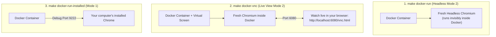

# Complete Guide to the Boilerplate (Easy & Practical)

Welcome! This project is a ready-to-use starter kit for **AI browser automation**. It uses **[browser-use](https://github.com/browser-use/browser-use)** and an **AI API key** (we recommend **Google Gemini** because it is fast, supports screenshots, and costs the least).

---

## 1. The Big Picture: 2 Browser Modes & 2 Ways to Run

Before running anything, there are only two choices you ever make:

### Choice A: Which Browser Should the AI Control?

| Mode | Name in `.env` / CLI | How It Works | Best For |
|---|---|---|---|
| **Mode 1: Installed Browser (Recommended)** | `installed` | Controls the **real Google Chrome installed on your computer**. Chrome stays open after the task finishes, so your logins, cookies, and open tabs stay alive all day. | Sites where you are already logged in (Google, dashboards, 2FA accounts). |
| **Mode 2: Fresh Instance** | `fresh` | Starts a **brand-new, separate browser** just for this run and closes it when done. It never touches your personal Chrome. | Clean scraping, testing, public forms, or running in the background on a server. |

### Choice B: How Do You Want to Run the Code?

| Approach | How It Works | Best For |
|---|---|---|
| **1. Native (Without Docker)** | Uses `uv` to run Python directly on your Mac, Linux, or Windows machine. | Everyday local development and controlling your desktop Chrome. |
| **2. With Docker** | Runs Python (and optionally the browser) inside a container so you don't have to install anything on your machine except Docker. | Servers, team sharing, or clean isolated environments. |

---

## 2. First-Time Setup (Takes 2 Minutes)

Open a terminal inside `browser-use-boilerplate/`:

```bash
# 1. Create your .env file from the template
cp -n .env.example .env
```

Open `.env` in your editor and paste your Gemini API key:
```ini
LLM_PROVIDER=google
GEMINI_API_KEY=your_gemini_api_key_here
```
*(Want to use OpenAI, Claude, DeepSeek, Groq, or Ollama instead? See [docs/LLM_PROVIDERS.md](docs/LLM_PROVIDERS.md).)*

---

## 3. Running WITHOUT Docker (Native with `uv`)

If you are running directly on your laptop or desktop:

```bash
# 1. Install Python dependencies
make setup

# 2. Check that your API key and browsers are detected
make doctor

# 3. See all available tasks
make tasks
```

### Run in Mode 2 (Fresh Browser Instance)
Opens a brand-new browser window, runs the task, and closes the browser when finished:
```bash
make run-fresh TASK=hn_top_stories INPUT="count=5"
```
*(Tip: Add `HEADLESS=1` if you want it to run invisibly in the background.)*

### Run in Mode 1 (Your Installed Google Chrome)
Controls the Google Chrome installed on your device and leaves it open afterward:
```bash
# Optional: open the automation Chrome first so you can log in to your accounts once
make chrome

# Run any task inside that open Chrome window
make run-installed TASK=httpbin_form INPUT="customer=Salman email=salman@example.com size=large"
```

### Run a Quick One-Line Instruction (No Code Needed)
Want to test an idea without creating a file? Use `make prompt`:
```bash
make prompt P="Open https://example.com and tell me the main heading"
```

---

## 4. Running WITH Docker (Detailed Explanation)

If you prefer Docker, the project includes three Docker files that work together:

1. **[Dockerfile](Dockerfile):** Builds one container image that already has Python 3.12, `uv`, all Python packages, a standalone **Chromium** browser, and a virtual screen (**Xvfb + noVNC**) pre-installed.
2. **[docker-compose.yml](docker-compose.yml):** Defines two container modes (`bot` for Mode 2 inside Docker, and `bot-installed` for Mode 1 connecting to your host's Chrome). It also links your local `./logs`, `./profiles`, and `./app/tasks` folders into the container — so **when you edit a task file on your computer, you do NOT need to rebuild the Docker image**.
3. **[docker-compose.linux.yml](docker-compose.linux.yml):** A small helper file used automatically on Linux so the container can talk to your host computer's Chrome over `127.0.0.1:9222`.



First, build the Docker image once:
```bash
make docker-build
```

Then choose whichever of the **3 Docker commands** fits your situation:

### Command 1: `make docker-run` — Invisible Background Browser (Mode 2)
- **What it does:** Starts a fresh, invisible (headless) Chromium browser **inside** the container, finishes the task, saves the result and screenshot into `./logs/`, and shuts down.
- **When to use it:** On servers, cron jobs, or when you just want the output without any window popping up.
```bash
make docker-run TASK=hn_top_stories INPUT="count=5"
```

### Command 2: `make docker-vnc` — Watch the Docker Browser Live on Your Screen (Mode 2)
- **What it does:** Normally, you cannot see inside a Docker container because it has no monitor. `make docker-vnc` turns on a virtual screen inside the container and streams it to a web page on port `6080`.
- **When to use it:** When building or debugging a task in Docker and you want to watch the AI click and type in real time — or click inside the window yourself to pass a login/2FA screen.
```bash
make docker-vnc TASK=httpbin_form INPUT="customer=Salman"
```
While it is running, open **[http://localhost:6080/vnc.html](http://localhost:6080/vnc.html)** in your regular browser and click **Connect** to watch it live.

### Command 3: `make docker-run-installed` — Container Controls Your Computer's Chrome (Mode 1)
- **What it does:** Runs Python and `browser-use` inside Docker, **but does not start a browser inside Docker**. Instead, the container reaches out to port `9222` and controls the Google Chrome window open on your Mac, Linux, or Windows desktop.
- **When to use it:** You want your Python dependencies containerized in Docker, **and** you want the actions performed in your real desktop Chrome where you are already logged in.
```bash
# Step 1 (on your computer): start your installed Chrome with the debug port open
make chrome

# Step 2: run the Docker container — it attaches to that Chrome window
make docker-run-installed TASK=hn_top_stories INPUT="count=5"
```

---

## 5. How to Modify the Project for Your Own Process

To automate a new workflow, **you only create ONE new file inside `app/tasks/`**. You do not need to edit any other file in the repository.

### Step 1: Create `app/tasks/my_task.py`

Copy this template:

```python
from typing import Literal
from pydantic import BaseModel, Field
from app.tasks.base import BaseTask

# 1. List the possible final statuses for your process
Outcome = Literal[
    "SUCCESS",
    "NOT_FOUND",
    "NEEDS_LOGIN",
]

# 2. Define the exact data you want back at the end
class MyResult(BaseModel):
    outcome: Outcome = Field(description="The final status code.")
    summary: str = Field(default="", description="Main value extracted from the page.")
    evidence: str = Field(default="", max_length=300, description="Exact text on the page proving the outcome.")

# 3. Describe your task and write the step-by-step instructions
class MyTask(BaseTask):
    name = "my_task"                                  # Name used in `make run TASK=my_task`
    description = "Short description of my task."
    required_inputs = ["query"]                       # Passed via INPUT="query=..."
    optional_inputs = {"limit": 3}

    start_url = "https://example.com"                 # Page opened before Step 1 (optional)
    allowed_domains = ["example.com"]                 # AI cannot leave these domains (optional)
    Output = MyResult
    max_steps = 12

    def prompt(self) -> str:
        q = self.inputs["query"]
        return f"""Look up "{q}" on the website.

Steps:
1. You are on https://example.com.
2. If you see a login page or captcha, stop immediately and finish with NEEDS_LOGIN.
3. Search for "{q}" and read the main heading.
   - If nothing matches, finish with NOT_FOUND.
   - Otherwise, put the heading in `summary` and finish with SUCCESS.

Finish with done and the structured result.
"""
```

### Step 2: Run Your New Task

As soon as you save the file, it is automatically available everywhere:

```bash
# Check that it shows up in the task list
make tasks

# Run it natively in a fresh browser (Mode 2)
make run-fresh TASK=my_task INPUT="query=hello"

# Or run it natively in your installed Chrome (Mode 1)
make run-installed TASK=my_task INPUT="query=hello"

# Or run it in Docker
make docker-run TASK=my_task INPUT="query=hello"
```

### Step 3 (Optional): Call It from Your Own Python Script or API

If you want to trigger your task from another Python script, FastAPI endpoint, or queue worker:

```python
import asyncio
from app.runner import run_task

async def main():
    result = await run_task(
        "my_task",
        inputs={"query": "hello"},
        mode="fresh",   # or "installed"
    )
    if result.ok:
        print("Outcome:", result.output["outcome"])
        print("Data:", result.output)
    else:
        print("Failed:", result.error)

asyncio.run(main())
```

---

## 6. Where Are Logs, Screenshots & Costs Saved?

Every run automatically saves three helpful files inside `./logs/`:

| Folder | What's Inside |
|---|---|
| `logs/screenshots/` | A PNG screenshot taken at the end of every run (`..._ok.png` or `..._fail.png`) so you can see exactly what was on screen. |
| `logs/api_cost/` | Daily log of token usage and USD cost per run (`make cost` prints today's total). Set `MAX_DAILY_LLM_COST=1.00` in `.env` to enforce a hard daily spending limit. |
| `logs/traces/` | A step-by-step `.jsonl` timeline showing every URL visited, every button clicked, and any errors encountered. |

---

## 7. Detailed Guides (`docs/`)

If you want to go deeper into any single topic, open the matching guide in `docs/`:

- **[docs/CREATING_TASKS.md](docs/CREATING_TASKS.md)** — Full guide to creating tasks, handling passwords safely (`sensitive_env`), and adding custom Python functions (`@tools.action`).
- **[docs/BROWSER_MODES.md](docs/BROWSER_MODES.md)** — How Mode 1 (`installed`) and Mode 2 (`fresh`) work, how profiles are saved, and how to copy your everyday Chrome profile (`make copy-profile`).
- **[docs/DOCKER.md](docs/DOCKER.md)** — Full explanation of `Dockerfile`, `docker-compose.yml`, `docker-compose.linux.yml`, and the 3 `make docker-*` commands.
- **[docs/PROMPTING_GUIDE.md](docs/PROMPTING_GUIDE.md)** — Practical tips for writing reliable instructions (preventing double-clicks, waiting for slow spinners, handling foreign languages).
- **[docs/LLM_PROVIDERS.md](docs/LLM_PROVIDERS.md)** — How to switch between Gemini, OpenAI, Claude, DeepSeek, Groq, OpenRouter, or local Ollama models.
- **[docs/ARCHITECTURE.md](docs/ARCHITECTURE.md)** — How the code files in `app/` connect to each other.
- **[docs/TROUBLESHOOTING.md](docs/TROUBLESHOOTING.md)** — Quick solutions for common browser, port, lock-file, or Docker issues.
