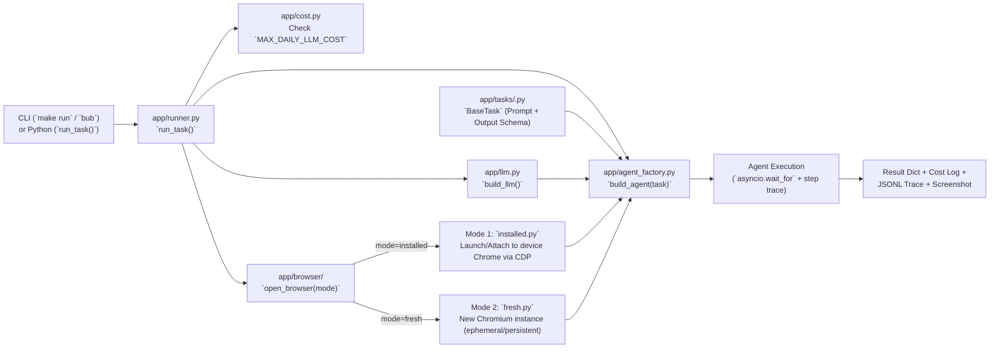

# Architecture & Execution Lifecycle

This document explains how the boilerplate is organized and where to hook in your own services (REST APIs, job queues, cron schedulers, or databases).

---

## High-Level Flow

---

## Module Responsibilities

| File | Responsibility | When to Modify |
|---|---|---|
| [`app/tasks/*.py`](../app/tasks/) | Defines each automation process (`prompt()`, `Output` schema, `allowed_domains`, inputs). | **Every time you add or update a business process.** |
| [`app/config.py`](../app/config.py) | Loads `.env` into a typed `Settings` dataclass and sets safe environment defaults (`NO_PROXY` for localhost CDP, telemetry off). | When adding a new global `.env` setting. |
| [`app/llm.py`](../app/llm.py) | Maps `LLM_PROVIDER` + `LLM_MODEL` + `LLM_API_KEY` to the matching `browser-use` chat class. | Only if adding a brand-new LLM SDK. |
| [`app/browser/installed.py`](../app/browser/installed.py) | Cross-platform Chrome detection (macOS/Linux/Windows), detached `--remote-debugging-port` launcher, profile lock check, and `copy_profile()`. | If customizing Chrome launch flags for Mode 1. |
| [`app/browser/fresh.py`](../app/browser/fresh.py) | Creates ephemeral (`tempfile.mkdtemp`) or persistent (`./profiles/fresh/<name>`) profiles for Mode 2. | If customizing Mode 2 browser options. |
| [`app/browser/cdp.py`](../app/browser/cdp.py) | Zero-dependency HTTP client for `/json/version` and `/json/list` that bypasses system proxies and rewrites WebSocket URLs for Docker. | Rarely needed. |
| [`app/agent_factory.py`](../app/agent_factory.py) | Applies production defaults (`max_actions_per_step=1`, `max_history_items=6`, `use_judge=False`, `directly_open_url=False`) and wires `start_url`, `Output`, and `sensitive_data`. | If changing global agent behavior across all tasks. |
| [`app/runner.py`](../app/runner.py) | Orchestrates one task run: budget guard, timeout, structured output parsing, `postprocess()`, screenshot capture, cost logging, trace writing, and browser cleanup. | If integrating global webhooks (e.g., Slack/DB) on every task completion. |
| [`app/cost.py`](../app/cost.py) & [`app/trace.py`](../app/trace.py) | Writes daily cost logs (`logs/api_cost/`) and step-by-step JSONL traces (`logs/traces/`). | If forwarding metrics or redacting custom PII fields. |

---

## Lifecycle of a Single Run (`run_task`)

1. **Resolve Task & Settings:** Loads `Settings.from_env()`, looks up the `BaseTask` subclass by name, and validates `required_inputs`.
2. **Daily Budget Check:** `cost.budget_exceeded(settings)` checks `logs/api_cost/api_cost_<today>.log`. If `MAX_DAILY_LLM_COST` is reached, returns `status="budget_exceeded"` without starting a browser.
3. **Open Browser (`open_browser`):**
   - **Mode 1 (`installed`):** Calls `ensure_chrome(settings)` (reuses running Chrome on `CDP_PORT` or launches it detached), resolves the CDP WebSocket URL, and creates `Browser(cdp_url=..., keep_alive=True)`.
   - **Mode 2 (`fresh`):** Creates an ephemeral or persistent profile folder and creates `Browser(headless=..., user_data_dir=..., keep_alive=False)`.
4. **Build Agent (`build_agent`):** Configures `Agent` with `task.prompt()`, `output_model_schema=task.Output`, `initial_actions` (if `start_url` is set), and `sensitive_data`.
5. **Execute with Timeout:** Runs `agent.run(max_steps=..., on_step_end=trace.on_step_end)` inside `asyncio.wait_for(..., timeout=...)`.
6. **Parse & Postprocess:** Extracts `task.Output` via `history.get_structured_output()` and passes it through `task.postprocess()`.
7. **Always-Run Cleanup (`finally` block):**
   - Captures a final screenshot to `logs/screenshots/`.
   - Reads token usage and appends a line to `logs/api_cost/api_cost_<today>.log`.
   - Closes the agent session.
   - Calls `handle.close()` (leaves installed Chrome alive in Mode 1; kills fresh Chromium and deletes ephemeral temp dir in Mode 2).
   - Writes the complete timeline to `logs/traces/trace_<today>.jsonl`.
