# Running with Docker — Easy & Complete Guide

This guide explains how the Docker setup works in plain English: what each Docker file does, when to use each of the 3 `make docker-*` commands, and how to choose between running **with Docker** vs **without Docker**.

---

## 1. Why Are There 3 Docker Files?

Inside the project root you will see three Docker files. Each has a clear, simple job:

### ① [`Dockerfile`](../Dockerfile) — The Container Recipe
Builds a single image that includes:
- **Python 3.12 + `uv`** and all project packages from `pyproject.toml`.
- **Chromium browser** (installed via Playwright) so the container can open web pages on its own.
- **Virtual screen tools (`Xvfb`, `x11vnc`, `noVNC`)** so that if you want to *watch* the browser inside the container, you can view it live in your regular web browser at `http://localhost:6080/vnc.html`.
- **International fonts** so pages in Japanese, Arabic, Chinese, or European languages render properly in screenshots.

### ② [`docker-compose.yml`](../docker-compose.yml) — The Wiring & Shared Folders
Defines two ready-to-run services that both use the same image:
- **`bot` (Mode 2 — Fresh Browser Inside Docker):** Runs a clean Chromium browser inside the container.
- **`bot-installed` (Mode 1 — Host Chrome):** Runs the Python AI agent inside Docker, but connects *outside* the container to the Google Chrome open on your Mac or Windows desktop (`host.docker.internal:9222`).

It also connects three folders from your computer directly into the container:
- `./app/tasks` → **You can create or edit tasks on your computer and run them immediately without rebuilding the Docker image.**
- `./logs` → Screenshots, cost logs, and traces created inside Docker appear directly in your local `logs/` folder.
- `./profiles` → Saved browser profiles persist even after the container stops.

### ③ [`docker-compose.linux.yml`](../docker-compose.linux.yml) — Linux Helper for Mode 1
On Linux, Docker handles `localhost` networking slightly differently than macOS and Windows. When you run `make docker-run-installed` on Linux, the `Makefile` automatically includes this file (`network_mode: host`) so the container can connect directly to your Linux desktop's Chrome at `127.0.0.1:9222`.

---

## 2. How the 3 `make docker-*` Commands Work

First, build the Docker image once (you only need to re-run this if you change `pyproject.toml` or `Dockerfile`):

```bash
make docker-build
```

After building, you have **three ways** to run tasks in Docker:

```mermaid
flowchart TB
    subgraph Cmd1["1. make docker-run (Invisible / Headless)"]
        A1["Docker Container (`bot`)"] --> A2["Starts fresh headless Chromium inside Docker"]
    end

    subgraph Cmd2["2. make docker-vnc (Watch Live on Port 6080)"]
        B1["Docker Container (`bot` + Virtual Screen)"] --> B2["Starts visible Chromium inside Docker"]
        B2 <-->|Port 6080| B3["You watch live at:<br/>http://localhost:6080/vnc.html"]
    end

    subgraph Cmd3["3. make docker-run-installed (Uses Your Computer's Chrome)"]
        C1["Docker Container (`bot-installed`)"] -->|Port 9222| C2["Controls Google Chrome<br/>running on your computer"]
    end
```



---

### Option 1: `make docker-run` (Mode 2 — Headless Inside Docker)

**What happens:**
1. Starts a temporary container.
2. Launches a brand-new, invisible (**headless**) Chromium browser inside the container.
3. Runs your task, writes the output, screenshot, and cost log to `./logs/`, and removes the container.

**When to use it:**
- Running on a cloud server or Linux VM with no monitor.
- Running background jobs, cron schedules, or CI tests.
- When you don't need to watch the browser window.

**Example:**
```bash
make docker-run TASK=hn_top_stories INPUT="count=5"
```

---

### Option 2: `make docker-vnc` (Mode 2 — Watch the Docker Browser Live!)

**What happens:**
1. Starts the container with a virtual monitor (`ENABLE_VNC=true` in [`scripts/docker-entrypoint.sh`](../scripts/docker-entrypoint.sh)).
2. Launches Chromium in **headed** (visible) mode inside that virtual monitor.
3. Streams the container's screen to **`http://localhost:6080/vnc.html`**.

**When to use it:**
- You are developing or debugging a new task in Docker and want to see what the AI sees.
- You are using a persistent fresh profile (`FRESH_PROFILE=persistent` in `.env`) and want to manually type in your username/password/2FA code inside the container's browser using your mouse and keyboard.

**Example:**
```bash
# 1. Start the run
make docker-vnc TASK=httpbin_form INPUT="customer=Salman"

# 2. Open http://localhost:6080/vnc.html in your browser and click "Connect"
```

---

### Option 3: `make docker-run-installed` (Mode 1 — Container Controls Your Desktop Chrome)

**What happens:**
1. You open your computer's regular Google Chrome with its debugging port turned on (`make chrome`).
2. You run `make docker-run-installed`.
3. The Python agent runs inside Docker, connects out to your computer's Chrome over port `9222`, and performs the steps inside your desktop Chrome window.

**When to use it:**
- You don't want to install Python/`uv` on a machine (only Docker + Chrome), **and**
- You need to automate a website inside your device's real Chrome where you are already logged in (such as Google accounts).

**Example:**
```bash
# Step 1 — On your computer, launch Chrome with debug port 9222:
make chrome

# Step 2 — Run the container attached to that Chrome:
make docker-run-installed TASK=hn_top_stories INPUT="count=5"
```

---

## 3. Quick Decision Table: Which Command Should I Run?

| What You Want to Do | Command to Run |
|---|---|
| Run **without Docker**, using a **new separate browser** | `make run-fresh TASK=my_task INPUT="..."` |
| Run **without Docker**, using **my computer's installed Chrome** | `make run-installed TASK=my_task INPUT="..."` |
| Run **in Docker**, invisibly in the background (new browser inside Docker) | `make docker-run TASK=my_task INPUT="..."` |
| Run **in Docker**, and **watch the browser live** at `http://localhost:6080/vnc.html` | `make docker-vnc TASK=my_task INPUT="..."` |
| Run **in Docker**, but control **my computer's installed Chrome** | `make chrome` then `make docker-run-installed TASK=my_task INPUT="..."` |
